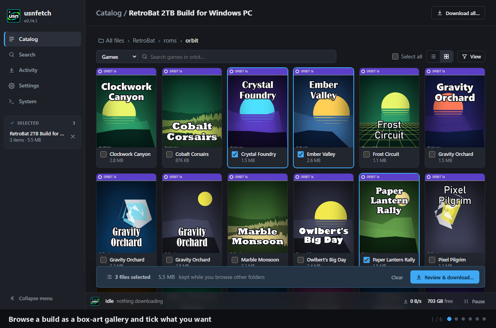

# usnfetch

usnfetch downloads `usn://` links from your own Usenet provider. Each link opens a share: a
collection of files, encrypted and posted to Usenet. usnfetch runs in the background with a web
page you keep open in a tab, like SABnzbd or the *arr apps.

I wanted that for `usn://` links. Getting a share into SABnzbd meant a bridge app, so usnfetch
does the whole job itself. It fetches the articles, decrypts them and checks every file against
the share's SHA-256.

It's an independent project and doesn't come with any shares. You bring your own links, and what
you download is up to you.

*The builds, consoles and games in these screenshots are made up.*

## What it does

- Browse a share before you download it, with a box-art gallery for game builds.
- Download what you tick, or the whole share. It shows the size and your free space first.
- Search every build you've opened for a game or a BIOS file.
- Search inside one build by kind: games, BIOS, videos, pictures, music, documents, archives.
- Put games straight into RetroBat, Batocera, ES-DE / EmuDeck or LaunchBox, art included.
- Keep one copy of each game, in the region you want.
- Keep a catalog of your links: what's in each build, and whether it's still on your provider.
- Queue, pause, reorder, limit the speed, set a schedule.
- Use more than one provider, with priorities like SABnzbd.

## What you need

- A Usenet provider account.
- The `usn://` links of the shares you want.
- 7-Zip or UnRAR (on Linux, the `7zip` package), if you want archives unpacked.
- Windows 10 or 11, Linux (64-bit, including a Raspberry Pi 4 or 5), or a Mac with Apple silicon
  (that one's untested).

## Getting started

1. Get the latest build from [Releases](https://github.com/dothiggity/usnfetch/releases):

   | You have | Download |
   | --- | --- |
   | Windows | `windows-amd64.zip`, or `windows-arm64.zip` for Windows on Arm |
   | Linux | `linux-amd64.tar.gz`, or `linux-arm64.tar.gz` for a Raspberry Pi |
   | Mac | `darwin-arm64.tar.gz` |

2. On Windows, unzip it and double-click `usnfetch.exe`. It sits by the clock and opens
   http://localhost:7979/. Anywhere else, run `usnfetch serve`.
3. Setup asks for your Usenet provider (it can copy yours from SABnzbd) and a download folder.
4. Add links. **Catalog → Add** imports a list of `usn://` links or opens one share, and
   **Activity → Add links** downloads whole shares.

The builds aren't code-signed yet, so Windows may say it protected your PC. Check the zip against
the checksums file on the release page, then choose More info → Run anyway.

## Updating

Stop usnfetch, replace `usnfetch.exe` (or `usnfetch`) with the new one, and start it again.
Settings, the catalog and your downloads stay. The release notes say if anything else is needed.

## Good to know

- **Downloads** get a folder per share in your download folder. A single `.zip` or `.7z` stays
  zipped, RAR sets get unpacked. You can change both under Options when you download.
- **Search** only knows the builds you've opened or downloaded. The line under each Download
  button says where it goes, and its arrow has the other way.
- **Libraries** are the devices you play on. Add each one in Settings → Libraries and give it a
  name, like "Living room PC". When you download, pick it under Save to. Games go into that
  device's folder for their system, BIOS files into its BIOS folder.
  - RetroBat and Batocera also get each game's art, video, manual and `gamelist.xml` entry.
    Nothing else in the list changes, and the old list is kept as a backup. Then
    EmulationStation reloads. For Batocera on another computer, turn on System settings →
    Frontend developer options → Enable public web API access.
  - ES-DE and EmuDeck get the art in `downloaded_media`. Their game lists aren't touched.
  - LaunchBox gets the game in `Games\<Platform>` with its art, and adds it itself
    (Tools → Scan → For Added ROMs).
- **One copy per game** is a checkbox when you download. The region order is in Settings →
  Downloads → Preferred regions.
- **Providers** with the same priority download together. A lower one (bigger number) only
  fills in what the others are missing, which is what you want for a block account.
- **Advanced settings** stay hidden until you turn on Show advanced at the top of Settings.
  Anything you've changed stays visible.
- **System → Reset** clears the caches or starts over. It never touches downloaded files.

## Using it from another computer

Set a web password first (Settings → Web access, or `usnfetch set-password`). Then start it with
`--host 0.0.0.0` and go to `http://<that computer>:7979/`. Without a password it only answers on
its own computer.

On Linux, a systemd unit like this runs it as a service:

    [Service]
    User=usnfetch
    ExecStart=/opt/usnfetch/usnfetch serve --data /srv/usnfetch --host 0.0.0.0
    Restart=on-failure

    [Install]
    WantedBy=multi-user.target

## Where it keeps things

One data folder: `%LOCALAPPDATA%\usnfetch` on Windows, `~/.local/share/usnfetch` on Linux,
`~/Library/Application Support/usnfetch` on a Mac, or wherever `--data` says. An empty file
called `portable` next to `usnfetch.exe` keeps it beside the program instead. Settings and the
System page show which folder it's using.

Each share you open leaves its index there (about 100 MB per TB), so it opens in seconds next
time. It keeps up to 20 GB of full indexes (an advanced setting). Past that, older ones keep just
their file list.

Provider passwords are encrypted on Windows. On Linux and macOS they're in the settings file,
which only your user can read.

## Privacy

usnfetch only connects to your Usenet providers, and to your front-end if you give a library a
reload address. No telemetry, no update check.

## Status

It's still 0.x. I use it every day, but things change between versions, and the release notes
say what.

## Command line

    usnfetch list  --link usn://… --server … --user … --pass …     # what's in a share
    usnfetch fetch --link usn://… --file NAME --out PATH --verify  # grab one file

The account can also come from `USNFETCH_SERVER`, `USNFETCH_PORT`, `USNFETCH_SSL`,
`USNFETCH_USER` and `USNFETCH_PASS`.

## Building it yourself

You need Go 1.27:

    go build -o bin/usnfetch.exe ./cmd/usnfetch

[CONTRIBUTING.md](CONTRIBUTING.md) has the tests, the code layout and how releases are made.

## Bugs and security

Found a bug? Open an issue. For a security problem, use Report a vulnerability on the Security tab
instead, so it isn't public.

## License

MIT, see [LICENSE](LICENSE). `internal/share/gcmstream.go` borrows a piece of Go's standard
library and keeps Go's BSD notice.
