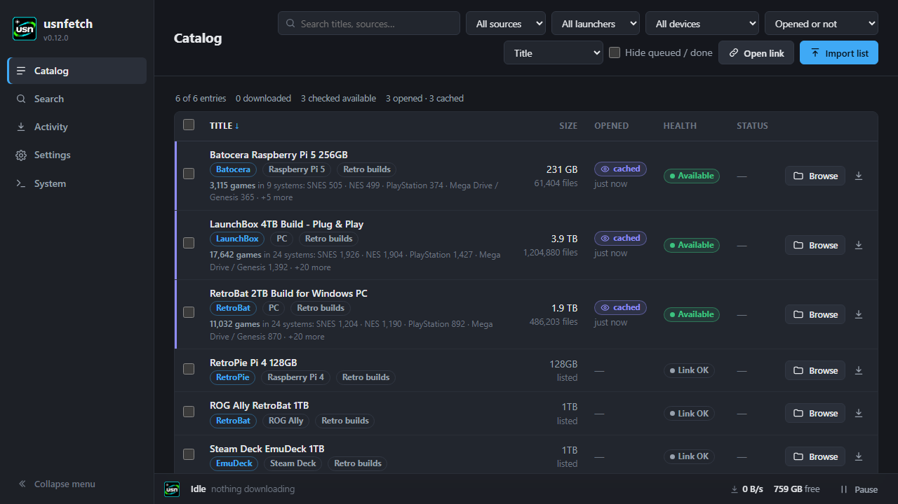

# usnfetch

usnfetch downloads usn:// shares straight from your own Usenet provider. It's a single
program with a web page you leave open in a tab, a bit like SABnzbd or the *arr apps: you add
share links, look through what's in them, pick what you want, and it lands on your disk,
decrypted and checked.

I wanted that workflow for `usn://` links. Getting a share into SABnzbd meant a bridge app that
never quite worked, so usnfetch does the whole job itself: it fetches the articles, decrypts them
as they arrive, and checks every file against the share's SHA-256.

It's an independent project, not affiliated with any other app, and it doesn't come with any
shares. You bring your own links, and what you download is up to you.

## What it does

- **Browse a share** before downloading: its folders and files, a box-art gallery for game builds
  (LaunchBox, RetroBat and other EmulationStation setups), and previews of videos, pictures and
  text streamed straight from Usenet.
- **Download what you tick, or the whole thing.** A review first shows the size next to your free
  space, where it lands, what's already on disk and which archives it'll unpack.
- **Search every build you've opened** for a game ("mario 3", "smb3", "ff7") or a BIOS ("ps1 bios
  usa"), and click the result to download it.
- **Keep a catalog** of your links, filtered by launcher and device (Batocera, RetroBat, Steam
  Deck, Raspberry Pi…), with what's inside each build and whether it's still on your provider.
- **A proper queue:** reorder, pause, speed limits, a weekly schedule. It pauses before the disk
  fills up, and on Windows the tray icon tells you when a download finishes.
- **Several providers** with priorities, like SABnzbd, all sharing your plan's connection limit.

## Getting started

There's nothing to install. Grab the latest build from the
[Releases page](https://github.com/dothiggity/usnfetch/releases): `windows-amd64` for most PCs,
`linux-amd64` or `linux-arm64` (a 64-bit Raspberry Pi 4 or 5).

On Windows, unzip it anywhere and double-click `usnfetch.exe`. It settles in next to the clock and
opens http://localhost:7979/ in your browser; right-click it there to pause, restart or start it
with Windows (Windows 11 may tuck it behind the ^ arrow). Anywhere else, run `usnfetch serve`.

The first time, a short setup asks for your Usenet provider (it can copy your servers from
SABnzbd, passwords and all) and where downloads should go. Then bring in your links:

- **Catalog → Import list:** a file or pasted text with `usn://` links in it. Exported lists with
  titles and sizes keep them. Importing again only adds what's new.
- **Catalog → Open link:** look inside one share before deciding.
- **Activity → Add links:** download one or more shares whole.

## Good to know

**Where downloads go.** Each one gets a folder of its own in your download folder, named after the
share. Single `.zip` and `.7z` files stay zipped by default, since ROM and BIOS packs are meant to;
RAR and multi-part sets are unpacked. You can change both per download.

**Search downloads.** A game that's one file of up to 1 GB, and any BIOS file, goes straight to
your browser's downloads. Bigger games, and games of several discs, go through the queue.

**More than one provider.** Priority 0 is the highest, and providers that share the top priority
download together. A lower one (a bigger number) is only asked for what the others are missing,
which suits a block account. Give each the full connection count your plan allows (Easynews: 60).

**Starting over.** A share's Details → Forget this build deletes what's saved about it, so it
opens like the first time. System → Reset does that for everything you tick, up to settings and
the first-run setup. Neither touches your downloaded files.

**Using it from another machine.** Set a web password first (Settings → Web access, or `usnfetch
set-password`), start it with `--host 0.0.0.0`, and browse to `http://<that machine>:7979/`. On
Linux, a systemd unit along these lines runs it as a service:

    [Service]
    User=usnfetch
    ExecStart=/opt/usnfetch/usnfetch serve --data /srv/usnfetch --host 0.0.0.0
    Restart=on-failure

## Where it keeps things

Settings, the catalog, history and the share index cache live in one data folder:
`%LOCALAPPDATA%\usnfetch` on Windows, `~/.local/share/usnfetch` on Linux, or wherever `--data`
says. An empty file called `portable` next to `usnfetch.exe` keeps it all beside the program
instead, say on a USB stick.

Each share you open leaves its index there (about 100 MB per TB), so it opens instantly next time.
The most recent ones are kept up to 20 GB; older ones are cut down to their zipped file list,
which still browses instantly. Settings → Downloads → Advanced changes the limit, and the System
page shows what it all takes.

Provider passwords are encrypted with Windows' data protection. Coming from the old Python
version? Point it at the same folder and it picks up your jobs, catalog and settings.

## Command line

    usnfetch list  --link usn://… --server … --user … --pass …     # what's in a share
    usnfetch fetch --link usn://… --file NAME --out PATH --verify  # grab one file

The account can also come from `USNFETCH_SERVER`, `USNFETCH_PORT`, `USNFETCH_SSL`,
`USNFETCH_USER` and `USNFETCH_PASS`.

## Building it yourself

You need Go 1.27. No C toolchain, so cross-compiling is just `GOOS`/`GOARCH`:

    go build -o bin/usnfetch.exe ./cmd/usnfetch
    go test ./...

The web page is plain JavaScript, baked into the program. `--web web` serves it from disk instead,
so a browser refresh shows your changes.

    cmd/usnfetch/      the program: serve, tray, list, fetch, set-password, version
    internal/share/    share links, manifests, the index, the games and BIOS files in a build
    internal/engine/   downloading: connections, decrypting, streaming, speed limit, checks
    internal/nntp/     a small NNTP client and each provider's connection budget
    internal/yenc/     yEnc decoding
    internal/app/      settings, the queue, the schedule, saved state, the index cache, resets
    internal/catalog/  reading link lists, launchers and devices
    internal/extract/  unpacking archives (7-Zip / UnRAR)
    internal/web/      the web API
    web/               the browser UI

Releases: write `.github/release-notes/v<version>.md`, set `Version` in `cmd/usnfetch/serve.go`,
commit, then `git tag -a v1.2.3 -m "usnfetch 1.2.3"` and `git push origin main v1.2.3`. GitHub
Actions tests it (on Linux with Go's race detector too) and publishes every download with
GoReleaser.

## License

MIT, see [LICENSE](LICENSE). `internal/share/gcmstream.go` borrows a piece of Go's standard
library and keeps Go's BSD notice.
